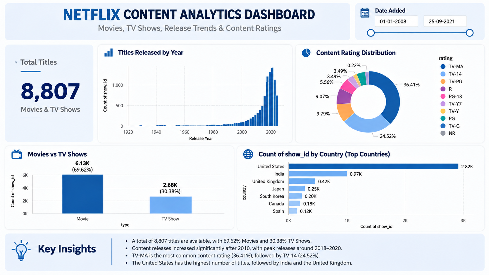

# SWYNEX Interactive Dashboard – Netflix Content Analytics

## Project Overview
This project presents a Netflix Content Analytics Dashboard created as part of the SWYNEX internship Task 3. The dashboard provides a visual overview of Netflix movies and TV shows, release trends, content ratings, and country-wise content distribution.

## Objectives
- Analyze the distribution of Movies and TV Shows.
- Identify content release trends by year.
- Understand content rating distribution.
- Explore countries contributing the most titles.
- Present key findings through a clear dashboard.

## Dashboard Features
- **Total Titles:** Displays the total number of titles in the dataset.
- **Titles Released by Year:** Shows the trend in content release years.
- **Movies vs TV Shows:** Compares the number of movies and TV shows.
- **Content Rating Distribution:** Visualizes ratings such as TV-MA, TV-14, and TV-PG.
- **Country-wise Distribution:** Highlights countries with the highest number of titles.
- **Date Added Filter:** Allows users to explore content based on the date added.

## Key Insights
- The dataset contains 8,807 titles.
- Movies account for approximately 69.62% of titles, while TV Shows account for 30.38%.
- Content releases increased significantly in recent years, with a peak around 2018.
- TV-MA is the most common content rating.
- The United States has the highest number of titles, followed by India and the United Kingdom.

## Tools Used
- Microsoft Power BI
- Netflix Movies and TV Shows dataset
- Data visualization and exploratory analysis

## Dashboard Preview

## Learning Outcomes
Through this project, I practised dashboard layout design, data visualization, filtering, and communicating insights from a dataset.

## Internship
**Organization:** SWYNEX Technologies  
**Task:** Task 3 – Interactive Dashboard
